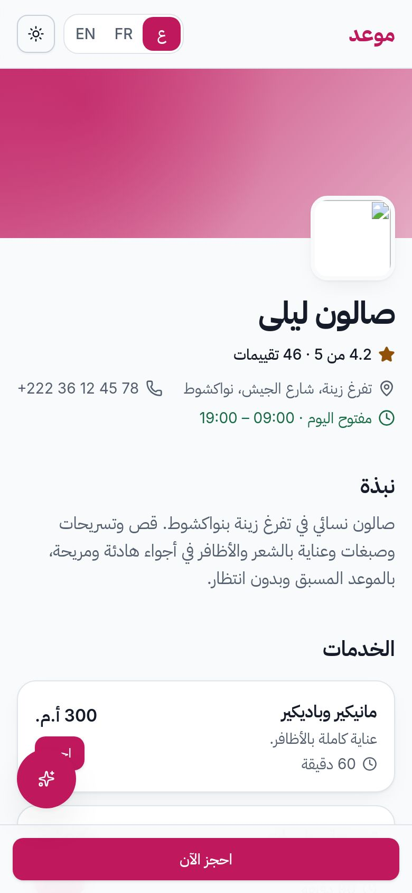
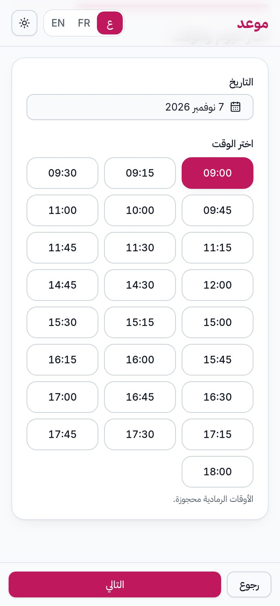
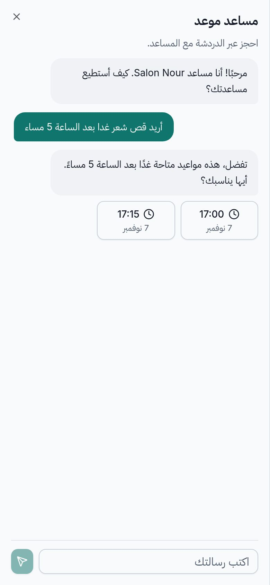
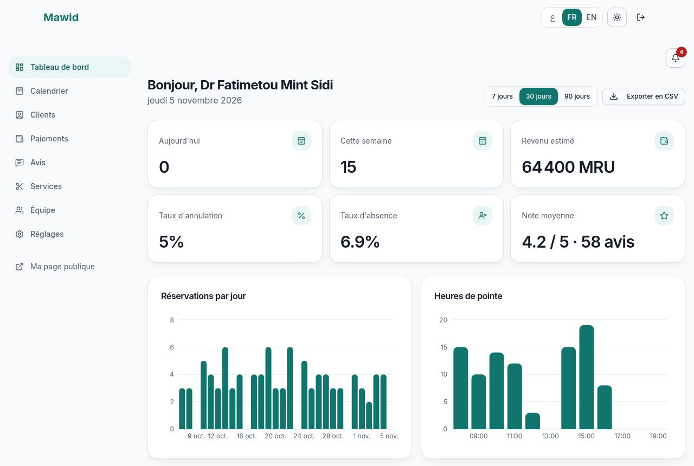
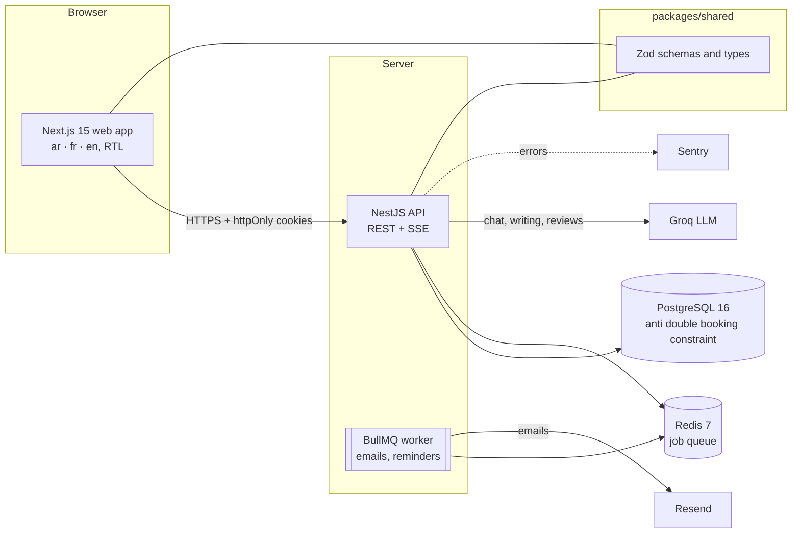

# Mawid | موعد

**Online booking for small service businesses** (salons, clinics, garages, restaurants) in Mauritania and beyond.
A customer books in a few seconds from a phone, in **Arabic (RTL), French or English**, with or without an AI
assistant. The owner manages the calendar, deposits, reviews and numbers from a dashboard.

<p align="center">
  
  
  
</p>
<p align="center">
  
</p>

## What it does

**For customers**
- A public page per business (services, team, opening hours, reviews) and a booking flow made for 360 px screens.
- **No double booking**: the database refuses two overlapping appointments of the same employee, even when two
  people click at the same millisecond.
- An **AI assistant** (Groq) that finds real free slots ("a haircut tomorrow after 5 pm"), prepares a draft, and
  books only after the customer's click. If the AI is down, the normal form keeps working.
- Confirmation and reminder emails (Arabic RTL too), calendar files, cancel or reschedule with a secret link,
  optional deposit by mobile payment, and a review page after the visit.

**For business owners**
- Calendar with drag and drop, customers, notification bell, manual bookings.
- Dashboard: bookings per day, top services, peak hours, cancellation and no-show rates, estimated revenue, CSV export.
- Services, team, working hours, breaks, days off, preparation time, automatic or manual confirmation.
- Deposits (validate or reject a proof), reviews (reply), QR code to share the page, "write with AI", review analysis.
- Plans with limits (Free, Pro, Business).

**For the platform administrator**
- All businesses, suspension, plans, global statistics, AI usage and estimated cost, failed emails with a retry button.

## Architecture



- **Monorepo (pnpm):** `apps/web` (Next.js 15, TypeScript strict, Tailwind, shadcn/ui, next-intl, TanStack Query),
  `apps/api` (NestJS 10, Prisma, PostgreSQL, Redis, BullMQ), `packages/shared` (Zod schemas shared by both).
- **Multi-tenant:** every business table has `business_id`; all queries go through one tenant-scoped client that
  forces it (and refuses raw SQL). Tested on every route.
- **Times** are stored in UTC and shown in the business time zone.
- **AI safety:** the key stays on the server; the model can only call 3 tools whose arguments are re-validated; a
  booking needs a signed draft and the customer's click; 14 injection attacks are tested.
- More: [`docs/SECURITY.md`](docs/SECURITY.md), [`docs/OPERATIONS.md`](docs/OPERATIONS.md),
  [`docs/DEPLOY.md`](docs/DEPLOY.md), [`docs/ACCEPTANCE.md`](docs/ACCEPTANCE.md),
  [`docs/openapi.json`](docs/openapi.json) (OpenAPI 3).

## Run it on your computer

Prerequisites: Node 20 or newer (22 recommended), pnpm 8, Docker.

```bash
pnpm install                                     # also builds packages/shared
cp apps/api/.env.example apps/api/.env           # fill in the secrets (see below)
cp apps/web/.env.example apps/web/.env.local
docker compose up -d                             # PostgreSQL (port 5434) + Redis (6379)
pnpm --filter api prisma:migrate                 # create the tables
pnpm --filter api db:demo                        # demo data: an Arabic salon and a French clinic
pnpm dev                                         # web http://localhost:3000, API http://localhost:4000
```

Open <http://localhost:3000/ar/b/demo-salon> (Arabic salon) or <http://localhost:3000/fr/b/demo-clinique> (French clinic).
Demo accounts, password `Demo1234!`: `demo.salon@demo.mawid.test`, `demo.clinic@demo.mawid.test` (owners),
`demo.admin@demo.mawid.test` (administrator). Running `pnpm --filter api db:demo` again resets the demo.

Minimum values in `apps/api/.env`: `JWT_SECRET` and `JWT_REFRESH_SECRET` (32+ characters each,
`openssl rand -base64 48`), `APP_URL`, `API_URL`, `MAIL_FROM`. Without `GROQ_API_KEY` the assistant is "unavailable"
and the normal booking works; without `RESEND_API_KEY` emails are printed in the API console.

Useful addresses: API health <http://localhost:4000/health>, readiness <http://localhost:4000/health/ready>,
Swagger <http://localhost:4000/docs> (development only).

## Tests and checks

```bash
pnpm lint && pnpm typecheck && pnpm test         # 290 unit and integration tests (needs PostgreSQL and Redis)
bash scripts/e2e-ci.sh                            # all browser tests on a fresh build (needs Chrome)
node apps/web/scripts/a11y.mjs                    # accessibility (axe) on every page
node apps/web/scripts/perf.mjs                    # load time on a throttled 4G connection
LIVE_GROQ=1 pnpm --filter api exec jest src/ai/ai-live   # the real AI model (needs GROQ_API_KEY)
```

CI (GitHub Actions) runs lint, types, tests and build, the browser tests, and builds the production Docker image.
Results of the acceptance check (AC-01 to AC-10): [`docs/ACCEPTANCE.md`](docs/ACCEPTANCE.md).

| Quality | Result |
|---|---|
| Lighthouse accessibility / best practices / SEO (public page) | 100 / 100 / 100 |
| axe (WCAG 2.1 A and AA), 89 page checks, 3 languages, light and dark | 0 serious or critical |
| Public page LCP on Fast 4G / Slow 4G (CPU 4x slower) | 0.6 s / 1.6 s |
| `pnpm audit --prod` | 2 findings, both explained in `docs/SECURITY.md` |

## Deploy

Web on **Vercel**, API + PostgreSQL + Redis on **Railway** (or Render, or one VPS with Docker). The exact steps,
every environment variable, the domain rule for cookies and a post-deploy checklist are in
[`docs/DEPLOY.md`](docs/DEPLOY.md). Production files: [`apps/api/Dockerfile`](apps/api/Dockerfile),
[`docker-compose.prod.yml`](docker-compose.prod.yml). Backups and restore: [`docs/OPERATIONS.md`](docs/OPERATIONS.md).

## User guides

- Français: [`docs/USER_GUIDE.md`](docs/USER_GUIDE.md)
- العربية: [`docs/USER_GUIDE.ar.md`](docs/USER_GUIDE.ar.md)

## Limitations

- **AI:** tested with a scripted model; the real model's behaviour (streaming with tools, refusals, the 2 s first word)
  must be checked once with your Groq key (`docs/ACCEPTANCE.md`). The default model names may change at Groq.
- **Payments:** deposits are checked by the owner by hand (mobile payment proof). The `PaymentProvider` interface is
  ready for Bankily, Masrvi or Stripe but no real provider is connected. Subscriptions are not billed: "upgrade to Pro"
  is a message, an administrator changes the plan.
- **Reminders** are sent by email only. WhatsApp and SMS have an interface and a stub, no provider.
- **Storage:** uploaded images (logos, photos, payment screenshots) are on a disk volume. Use private object storage
  with signed URLs before handling sensitive proofs at scale.
- **Deposit holds:** a booking waiting for its deposit keeps its slot until the owner decides (no automatic expiry).
- **Not built:** weekly summary by email (AI-06), voice booking (AI-07), waiting list (FR-38).
- **Security notes:** the web CSP keeps `'unsafe-inline'` for scripts (Next.js and the theme switch); no CAPTCHA on
  public booking. Two dependency advisories remain, with reasons, in `docs/SECURITY.md`.
- The email delivery check with a real mailbox (AC-10) and a timed manual booking on a phone (AC-01) are left to you.

## License

All rights reserved by the author unless a license file says otherwise. Fonts: Inter and IBM Plex Sans Arabic
(SIL Open Font License). Demo logos and avatars are original illustrations made for this project.
