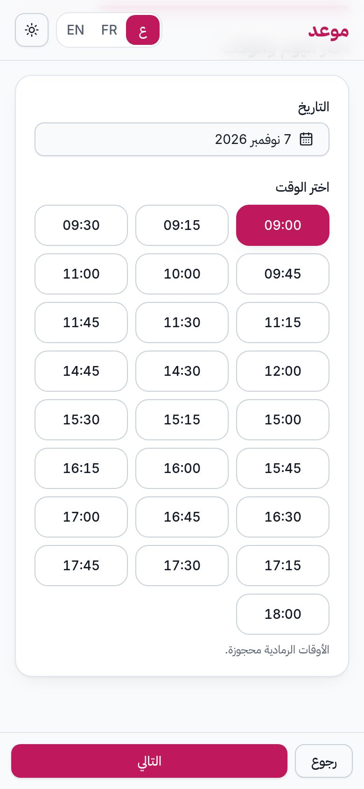
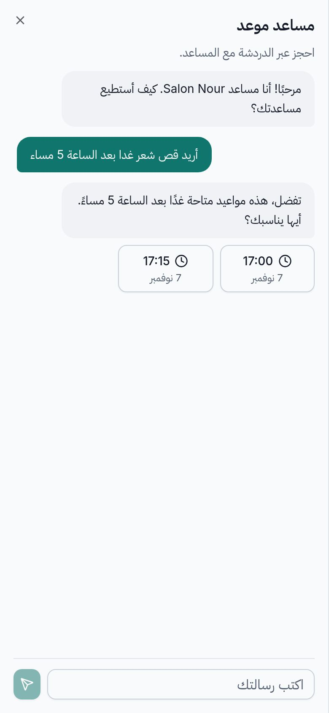
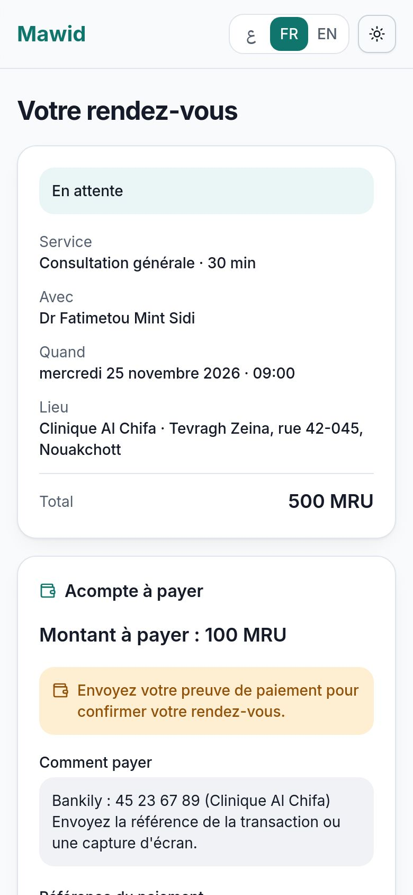
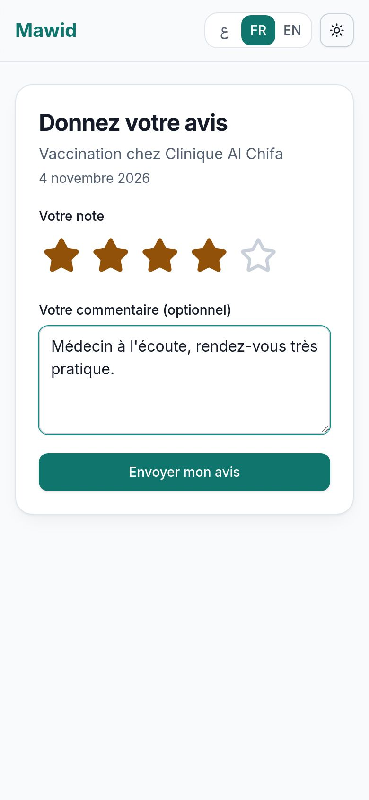
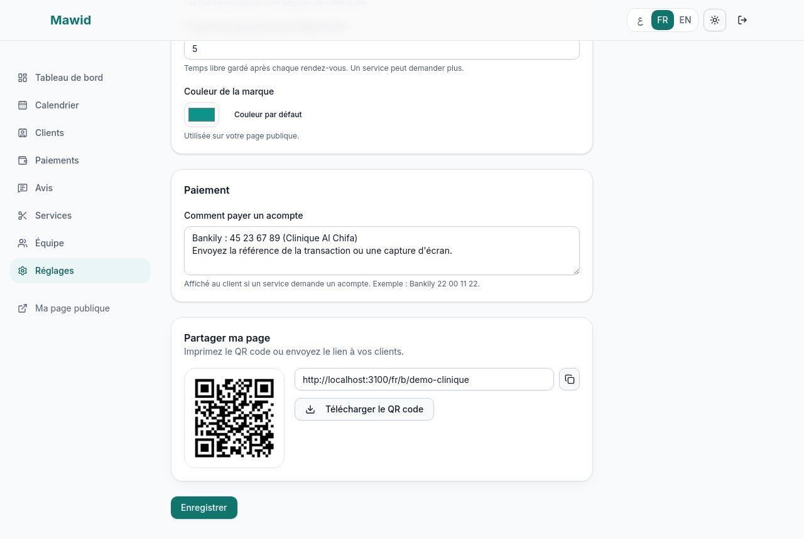
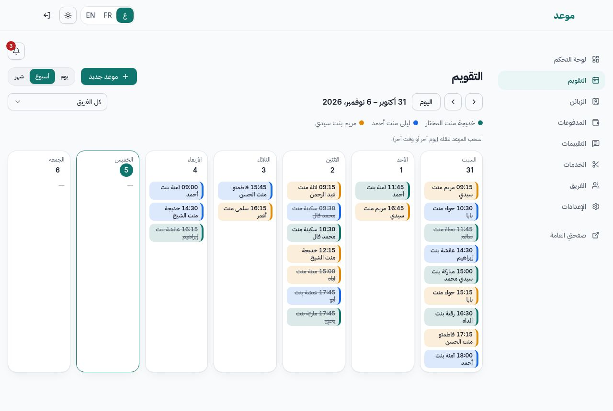
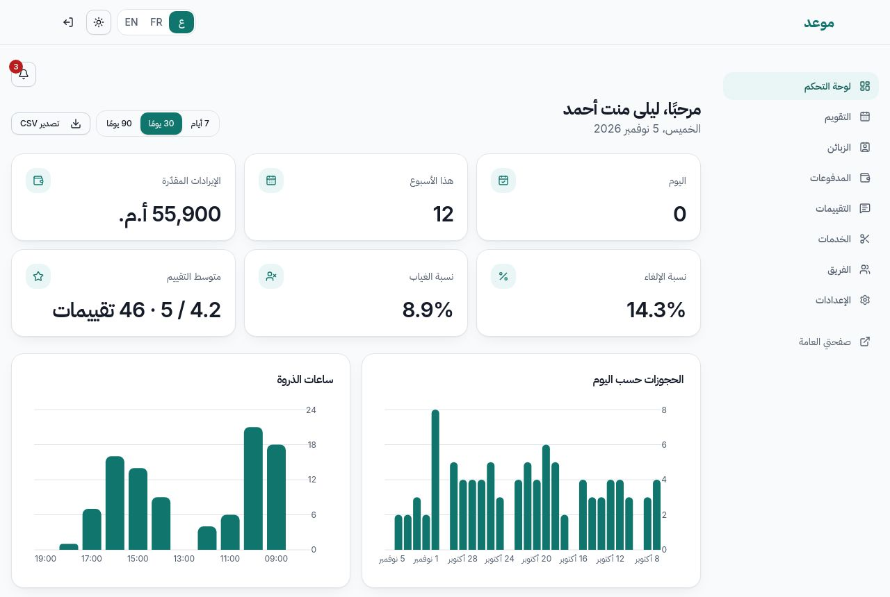

# دليل استخدام «موعد» (العربية)

النسخة الفرنسية: [USER_GUIDE.md](USER_GUIDE.md)

«موعد» يخدم حجز المواعيد وإدارتها. هذا الدليل قصير: يشرح ما يفعله **العميل** وما يفعله **صاحب المحل**.

## 1. للعملاء

### حجز موعد
1. افتح رابط صفحة المحل (أو امسح رمز QR). اختر اللغة من الأعلى: **ع / FR / EN**.
2. اضغط **احجز** بجانب الخدمة المطلوبة.
3. اختر الموظف، أو **لا يهمّ** (يُختار أول موظف متاح).
4. اختر **اليوم** ثم **ساعة متاحة**. تظهر فقط الساعات المتاحة فعلًا.
5. اكتب اسمك ورقم هاتفك (البريد الإلكتروني اختياري، لكنه يسمح بوصول التأكيد والتذكير).
6. اضغط **تأكيد الحجز**.

إذا سبقك شخص إلى الساعة نفسها فستظهر رسالة: اختر ساعة أخرى.

### استخدام المساعد الذكي
اضغط الزر **✦** أسفل الصفحة. اكتب مثلًا: «أريد قص شعر غدًا بعد الساعة 5 مساءً». يقترح المساعد **حتى 3 ساعات متاحة**.
اضغط على ساعة فيظهر **مسودة**. **لا يُحجز أي شيء حتى تكتب اسمك ورقم هاتفك وتضغط تأكيد.** إذا لم يجب المساعد، يوجّهك
زر إلى نموذج الحجز العادي.

### تغيير الموعد أو إلغاؤه
في رسالة التأكيد اضغط **إلغاء هذا الموعد أو تغييره**. يمكنك تغيير الساعة أو الإلغاء حتى الحد الذي يحدده المحل
(24 ساعة قبل الموعد افتراضيًا). بعد ذلك اتصل بالمحل. يمكنك أيضًا إضافة الموعد إلى تقويمك (ملف ‎.ics‎ أو Google).

### دفع العربون
بعض الخدمات تطلب عربونًا. بعد الحجز تعرض صفحة موعدك **طريقة الدفع** (مثلًا بنكيلي). ادفع من هاتفك ثم اكتب
**مرجع العملية** و/أو أرسل **لقطة شاشة**. يتحقق المحل فيصبح موعدك **مؤكدًا** وتصلك رسالة. إذا رُفض الإثبات
تخبرك الصفحة ويمكنك إرسال إثبات آخر.

### تقييم الزيارة
بعد الموعد تصلك رسالة تدعوك إلى تقييم الزيارة من **1 إلى 5 نجوم** وكتابة تعليق. تقييم واحد لكل موعد. يظهر تقييمك في
صفحة المحل باسمك الأول وحرف من اسمك الثاني.

## 2. لصاحب المحل

### إنشاء محلك
1. **أنشئ حسابًا** (الاسم، البريد، كلمة مرور من 8 أحرف أو أكثر) ثم اتبع معالج البداية: اسم المحل، عنوان الصفحة
   (مثل `salon-nour`)، الخدمات، الموظفون والأوقات.
2. صفحتك العامة جاهزة: `https://موقعك/ar/b/salon-nour`.

### ضبط المحل
قائمة **الإعدادات**:
- الملف التعريفي والشعار والوصف (زر **الذكاء الاصطناعي** يقترح نصًا: راجعه قبل استعماله)؛
- اللغة الافتراضية والمنطقة الزمنية ولون العلامة؛
- **نمط الحجز**: *تلقائي* (يُؤكَّد الحجز فورًا) أو *يدوي* (تقبل كل طلب بنفسك)؛
- مهلة الإلغاء، الحد الأدنى للإشعار المسبق، عدد الأيام المسبقة، خطوة المواعيد، و**وقت التحضير** بعد كل موعد؛
- **طريقة دفع العربون** (مثلًا «بنكيلي 22 00 11 22»).

**مشاركة الصفحة:** في أسفل الإعدادات انسخ الرابط أو نزّل **رمز QR** لطباعته.

### الخدمات والفريق
- **الخدمات**: الاسم، المدة، السعر، الفئة، وقت التحضير، و**عربون** اختياري (لا يتجاوز السعر).
- **الفريق**: أضف الموظفين، واختر خدماتهم وأوقات عملهم الأسبوعية واستراحاتهم. تُضبط الإجازات (يوم أو فترة)
  لموظف أو للمحل كله.

### التقويم
قائمة **التقويم**: عرض اليوم والأسبوع والشهر. **اسحب** الموعد لتغييره. المس الموعد لتأكيده أو إنهائه أو
تسجيل «غياب» أو إلغائه. **موعد جديد** للحجوزات عبر الهاتف أو في المحل. عندما تضع الموعد **منتهيًا** يصل العميل
بريد لتقييم الزيارة.

### العربون
قائمة **المدفوعات**: لكل عربون انظر إلى المرجع واللقطة ثم **اقبل** (يُؤكَّد الحجز) أو **ارفض** (يبقى قيد الانتظار
ويمكن للعميل إرسال إثبات آخر). يظهر تنبيه في الجرس عند وصول إثبات.

### التقييمات
قائمة **التقييمات**: اقرأ التقييمات و**ردّ** عليها. يظهر ردّك في الصفحة العامة. يظهر متوسط التقييم أعلى صفحة المحل.

### لوحة التحكم
أرقام اليوم والأسبوع، والإيرادات المقدّرة (الحجوزات المؤكدة والمنتهية)، ونسبة الإلغاء والغياب، ومتوسط التقييم،
ورسوم بيانية (الحجوزات حسب اليوم، ساعات الذروة، الخدمات الأكثر طلبًا). اختر **7 أو 30 أو 90 يومًا** وصدّر
الحجوزات بصيغة **CSV** (Excel). بطاقة **خطتي** تعرض حدودك (الموظفون، الحجوزات الشهرية، رسائل الذكاء الاصطناعي).

## 3. للمشرف
قائمة **الإدارة** (`/admin`) تعرض كل المحلات: بحث، **إيقاف** (تُحجب الصفحة العامة والحجوزات)، تغيير **الخطة**،
إحصاءات عامة، استعمال الذكاء الاصطناعي و**تكلفته المقدّرة**، وقائمة **الرسائل الفاشلة** مع زر «إعادة الإرسال».

## 4. أسئلة شائعة
- **لم تصلني الرسالة.** تحقق من البريد غير المرغوب. بدون بريد إلكتروني لا تُرسل أي رسالة.
- **لماذا لا تظهر ساعة معينة؟** لأنها محجوزة، أو في استراحة أو إجازة، أو قريبة جدًا (الإشعار المسبق)، أو بعيدة جدًا.
- **العميل يقول إن الساعة محجوزة والتقويم يبدو فارغًا.** وقت التحضير بعد الموعد السابق يُحسب وقتًا مشغولًا.
- **أريد قبول كل طلب بنفسي.** الإعدادات ← نمط الحجز ← *يدوي*.
- **المساعد الذكي لا يجيب.** يبقى نموذج الحجز العادي متاحًا. ربما بلغت حصتك الشهرية.
- **تقول رسالة إن خطتي ممتلئة.** تواصل مع المشرف للانتقال إلى الخطة الاحترافية.

