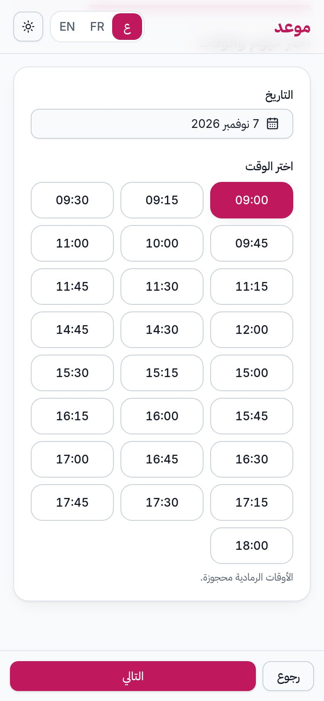
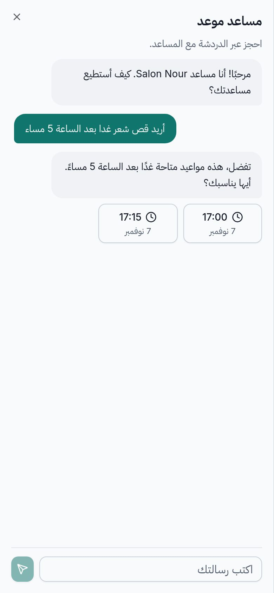
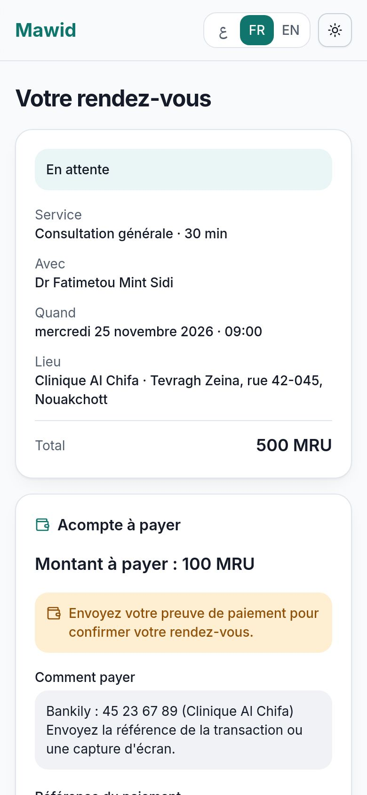
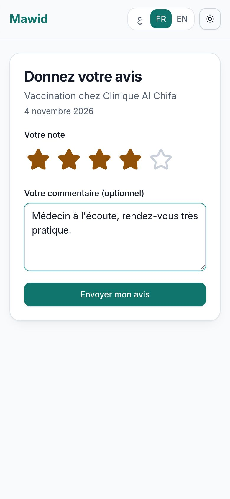
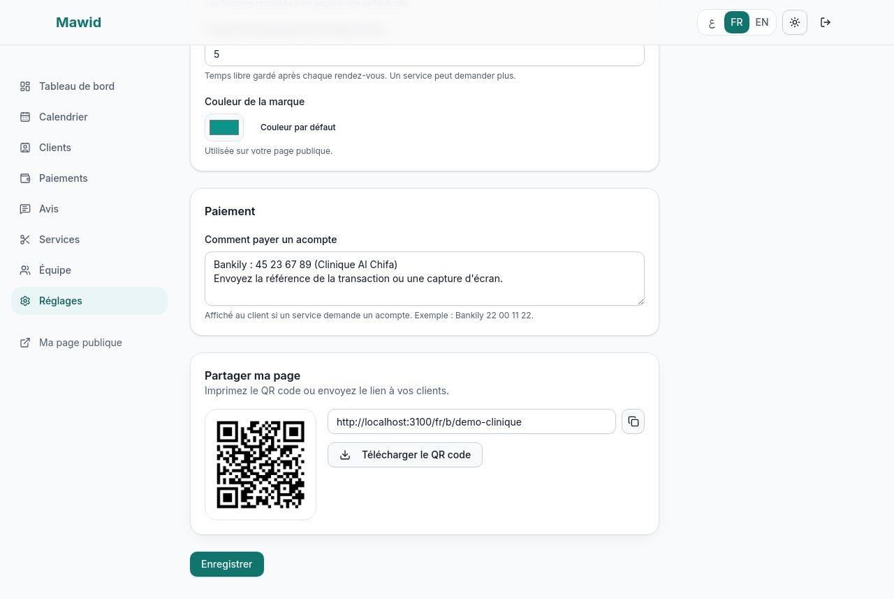
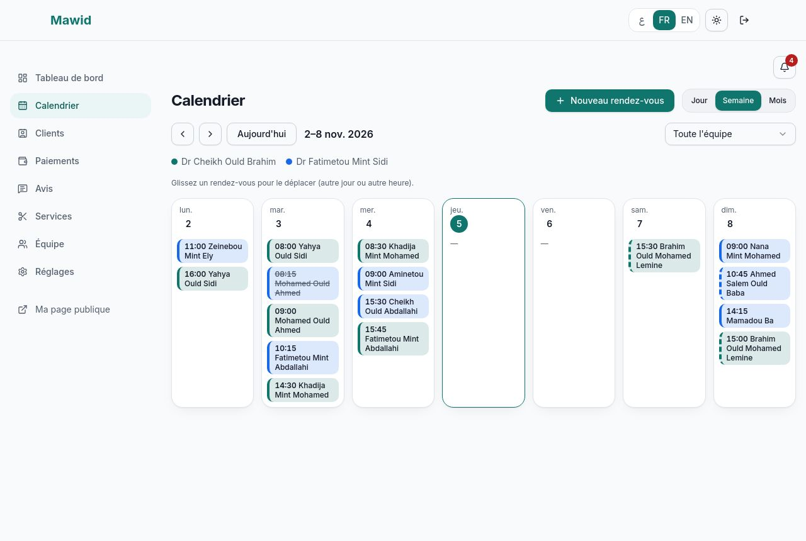
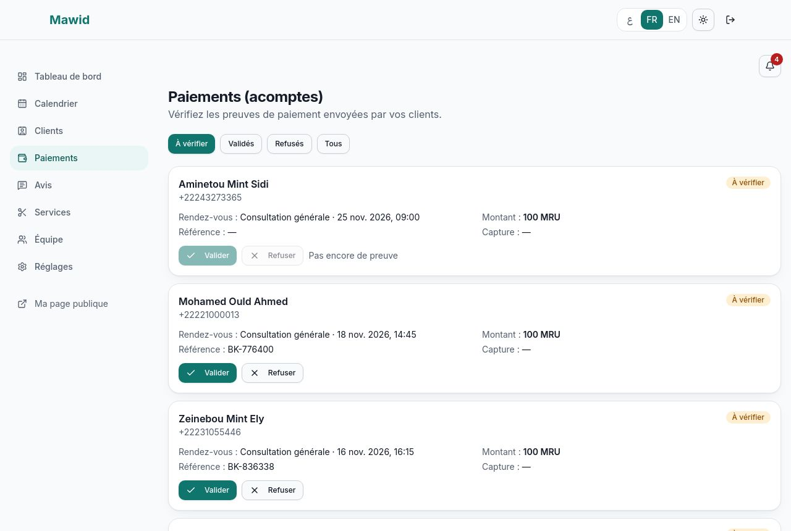
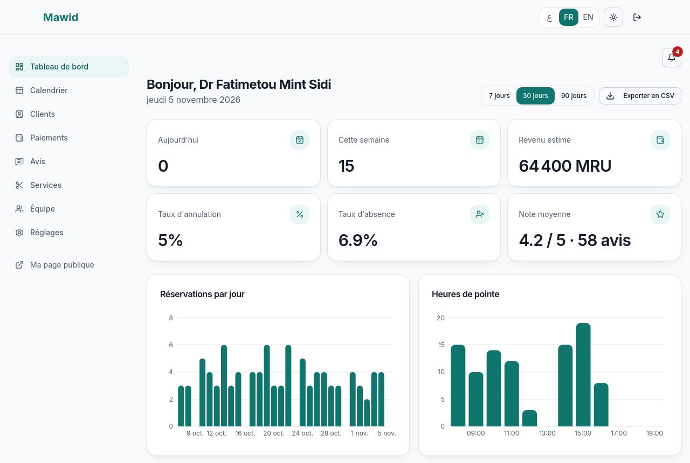
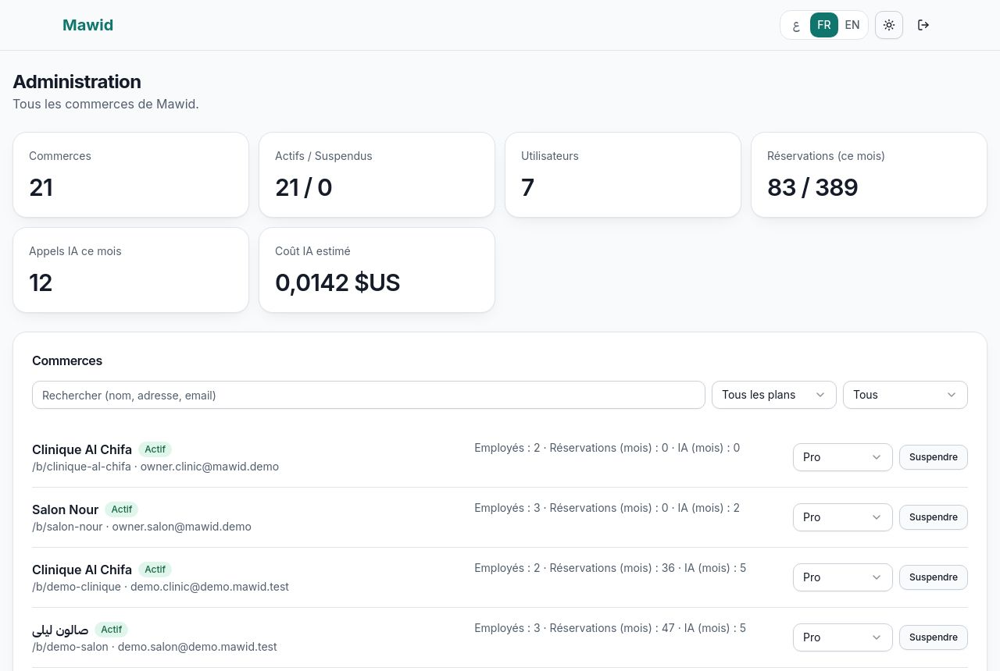

# Guide d'utilisation de Mawid (français)

Version arabe : [USER_GUIDE.ar.md](USER_GUIDE.ar.md)

Mawid sert à prendre et à gérer des rendez-vous. Ce guide est court : il explique ce que font **les clients** et
ce que fait **le propriétaire** du commerce.

## 1. Pour les clients

### Réserver un rendez-vous
1. Ouvrez le lien de la page du commerce (ou scannez son QR code). Choisissez la langue en haut : **ع / FR / EN**.
2. Appuyez sur **Réserver** à côté du service voulu.
3. Choisissez l'employé, ou **Peu importe** (le premier libre est choisi).
4. Choisissez le **jour**, puis une **heure libre**. Seules les heures vraiment libres sont proposées.
5. Écrivez votre nom et votre téléphone (l'email est facultatif, mais il permet de recevoir la confirmation et le rappel).
6. Appuyez sur **Confirmer la réservation**.

Si quelqu'un prend l'heure avant vous, un message vous le dit : choisissez une autre heure.

### Utiliser l'assistant IA
Appuyez sur le bouton **✦** en bas de la page. Écrivez par exemple « Je veux une coupe demain après 17 h ».
L'assistant propose **jusqu'à 3 heures libres**. Appuyez sur une heure : un **brouillon** apparaît. **Rien n'est réservé
tant que vous n'avez pas rempli votre nom et votre téléphone et appuyé sur Confirmer.** Si l'assistant ne répond pas,
un bouton vous renvoie vers le formulaire normal.

### Changer ou annuler
Dans l'email de confirmation, appuyez sur **Annuler ou changer ce rendez-vous**. Vous pouvez changer l'heure ou
annuler, jusqu'à la limite fixée par le commerce (24 heures avant par défaut). Passé ce délai, appelez le commerce.
Vous pouvez aussi ajouter le rendez-vous à votre agenda (fichier .ics ou Google Agenda).

### Payer un acompte
Certains services demandent un acompte. Après la réservation, la page de votre rendez-vous affiche **comment payer**
(par exemple Bankily). Payez avec votre téléphone, puis écrivez **la référence** de la transaction et/ou envoyez
**une capture d'écran**. Le commerce vérifie : votre rendez-vous passe à **Confirmé** et vous recevez un email.
Si la preuve est refusée, la page vous le dit et vous pouvez en envoyer une autre.

### Donner votre avis
Après le rendez-vous, un email vous invite à noter la visite de **1 à 5 étoiles** et à écrire un commentaire.
Un seul avis par rendez-vous. Votre avis apparaît sur la page du commerce avec votre prénom et l'initiale de votre nom.

## 2. Pour le propriétaire

### Créer votre commerce
1. **Créer un compte** (nom, email, mot de passe de 8 caractères ou plus), puis suivez l'assistant de démarrage :
   nom du commerce, adresse de la page (par exemple `salon-nour`), services, employés et horaires.
2. Votre page publique est prête : `https://votre-site/fr/b/salon-nour`.

### Régler le commerce
Menu **Réglages** :
- profil, logo, description (le bouton **IA** peut proposer un texte : vous le relisez avant de l'utiliser) ;
- langue par défaut, fuseau horaire, couleur de la marque ;
- **mode de réservation** : *automatique* (la réservation est confirmée tout de suite) ou *manuel* (vous acceptez chaque demande) ;
- délai d'annulation, préavis minimum, nombre de jours à l'avance, pas des créneaux, **temps de préparation** après chaque rendez-vous ;
- **consigne de paiement** pour les acomptes (par exemple « Bankily 22 00 11 22 »).

**Partager la page :** en bas des réglages, copiez le lien ou téléchargez le **QR code** pour l'imprimer.

### Services et équipe
- **Services** : nom, durée, prix, catégorie, temps de préparation, et **acompte** facultatif (jamais plus que le prix).
- **Équipe** : ajoutez les employés, choisissez leurs services, leurs horaires de la semaine, leurs pauses. Les congés
  (une journée, ou une période) se règlent aussi pour un employé ou pour tout le commerce.

### Le calendrier
Menu **Calendrier** : vues jour, semaine et mois. **Glissez** un rendez-vous pour le déplacer. Touchez-le pour le
confirmer, le terminer, le marquer « absent » ou l'annuler. **Nouveau rendez-vous** sert aux réservations prises par
téléphone ou au comptoir. Quand vous marquez un rendez-vous **Terminé**, le client reçoit l'email pour donner son avis.

### Les acomptes
Menu **Paiements** : pour chaque acompte, regardez la référence et la capture, puis **Valider** (la réservation est
confirmée) ou **Refuser** (elle reste en attente, le client peut renvoyer une preuve). Une alerte apparaît dans la cloche
quand une preuve arrive.

### Les avis
Menu **Avis** : lisez les avis et **répondez**. Votre réponse est visible sur la page publique. La note moyenne est
affichée en haut de la page du commerce.

### Le tableau de bord
Chiffres du jour et de la semaine, revenu estimé (réservations confirmées et terminées), taux d'annulation et
d'absence, note moyenne, graphiques (réservations par jour, heures de pointe, services les plus demandés). Choisissez
**7, 30 ou 90 jours** et exportez les réservations en **CSV** (Excel). La carte **Mon plan** montre vos limites
(employés, réservations par mois, messages IA).

## 3. Pour l'administrateur
Le menu **Administration** (`/admin`) liste tous les commerces : recherche, **suspension** (la page publique et les
réservations sont bloquées), changement de **plan**, statistiques globales, usage et **coût estimé de l'IA**, et la
liste des **emails en échec** avec un bouton « Renvoyer ».

## 4. Questions fréquentes
- **Je n'ai pas reçu l'email.** Regardez les courriers indésirables. Sans adresse email, aucun message n'est envoyé.
- **Pourquoi une heure n'est-elle pas proposée ?** Elle est prise, pendant une pause ou un congé, trop proche
  (préavis minimum), ou trop loin dans le futur.
- **Le client dit que l'heure est prise alors que le calendrier semble libre.** Le temps de préparation après le
  rendez-vous précédent compte comme du temps occupé.
- **Je veux accepter chaque demande moi-même.** Réglages → mode de réservation → *Manuel*.
- **L'assistant IA ne répond pas.** Le formulaire normal reste disponible. Le quota mensuel de votre plan est peut-être atteint.
- **Un message dit que mon plan est plein.** Contactez l'administrateur pour passer au plan Pro.
